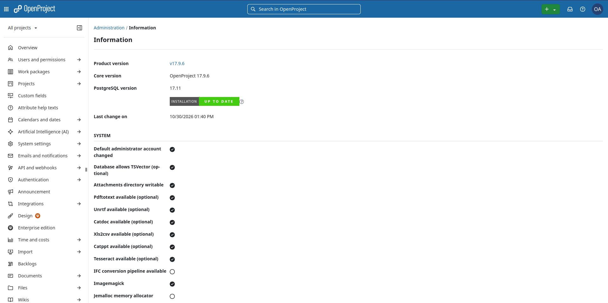

# OpenProject 17 on Ubuntu 26.04 with Docker Compose

Working install notes for **OpenProject stable/17** on **Ubuntu 26.04**, where the official **DEB packages are not available**. This guide documents pitfalls we hit in production (proxy image build, named volumes, parallel seeder migrations, bind address, systemd).

Upstream: [opf/openproject-docker-compose](https://github.com/opf/openproject-docker-compose) (`stable/17`).

---

## Why Docker (not apt)?

OpenProject packaged installs currently target older distros (e.g. Ubuntu 22.04). For Ubuntu 24.04+ / 26.04 they recommend **Docker Compose**. Using the 22.04 apt repo on 26.04 is unsupported and often fails apt security checks (`No Hash entry` / weak security information).

---

## System requirements

| Resource | Minimum | Recommended |
|----------|---------|-------------|
| OS | Ubuntu 26.04 (64-bit) | same |
| CPU | 2 vCPU | **4 vCPU** |
| RAM | **4 GB | **8 GB** |
| Disk | 20 GB free | 40+ GB SSD |
| Network | outbound HTTPS (image pulls) | + DNS if using FQDN |

** Low RAM during first `seeder` / DB migrate often causes a mid-migration crash → `PG::DuplicateTable` on restart.

---

## What this repo contains

| File | Purpose |
|------|---------|
| `docker-compose-example.yml` | Patched compose (seeder wait) — copy to `docker-compose.yml` on the server |
| `env.example` | Lab template — copy to `.env`, replace **`YOUR_SERVER_IP` only** for a demo |
| `systemd/openproject.service` | Start stack on boot as user `openproject` |
| `.gitignore` | Ignores `.env` (secrets) |

**Demo quick path:** after clone + user setup, only change the IP:

```bash
cp docker-compose-example.yml docker-compose.yml
cp env.example .env
sed -i 's/YOUR_SERVER_IP/192.168.202.106/g' .env   # your LAN IP
chmod 600 .env
```

You still need the rest of the upstream tree (`proxy/`, etc.). Typical layout on the server:

```text
/opt/openproject/          # owned by user openproject (not root)
  docker-compose.yml       # from docker-compose-example.yml
  .env                     # from env.example (YOUR_SERVER_IP replaced), mode 600
  proxy/                   # from upstream clone (required to build openproject/proxy)
```

**Do not run day-to-day compose as root.** Use the dedicated `openproject` OS user (Docker daemon stays root via systemd).

---

## 1. Install Docker Engine + Compose plugin

```bash
sudo apt update
sudo apt install -y ca-certificates curl
sudo install -m 0755 -d /etc/apt/keyrings
sudo curl -fsSL https://download.docker.com/linux/ubuntu/gpg -o /etc/apt/keyrings/docker.asc
sudo chmod a+r /etc/apt/keyrings/docker.asc

sudo tee /etc/apt/sources.list.d/docker.sources <<EOF
Types: deb
URIs: https://download.docker.com/linux/ubuntu
Suites: $(. /etc/os-release && echo "${UBUNTU_CODENAME:-$VERSION_CODENAME}")
Components: stable
Architectures: $(dpkg --print-architecture)
Signed-By: /etc/apt/keyrings/docker.asc
EOF

sudo apt update
sudo apt install -y docker-ce docker-ce-cli containerd.io docker-buildx-plugin docker-compose-plugin
sudo systemctl enable --now docker
docker --version
docker compose version
```

---

## 2. Create dedicated OS user `openproject`

```bash
sudo adduser --system --group --home /opt/openproject --shell /bin/bash openproject
sudo usermod -aG docker openproject

# Verify docker access (new group may need a new login session)
sudo -u openproject -H docker info >/dev/null && echo "docker OK for openproject"
```

If `docker info` fails with permission denied, log out/in or reboot once so the `docker` group applies, then retry.

| Item | Owner | Notes |
|------|--------|--------|
| `/opt/openproject` tree | `openproject:openproject` | compose, `.env`, backups |
| `.env` | `openproject:openproject`, mode **600** | edit as `openproject` — **no sudo** |
| `dockerd` | root | unchanged |

Members of the `docker` group can control the Docker engine (effectively privileged for containers). This is still better than doing all work in a root shell, and keeps secrets/files owned by one service account.

---

## 3. Clone OpenProject compose project

```bash
# Create the target directory first (chown fails if it does not exist;
# openproject cannot create /opt/openproject under /opt without write access)
sudo mkdir -p /opt/openproject
sudo chown openproject:openproject /opt/openproject

# Clone as openproject into the empty directory
sudo -u openproject -H git clone https://github.com/opf/openproject-docker-compose.git \
  --depth=1 --branch=stable/17 /opt/openproject

# If the directory already existed with a partial/root-owned clone, fix ownership:
sudo chown -R openproject:openproject /opt/openproject
```

Install the example compose + env as user `openproject`:

```bash
# From this docs/repo (adjust source path):
sudo -u openproject cp /path/to/this-repo/docker-compose-example.yml /opt/openproject/docker-compose.yml
sudo -u openproject cp /path/to/this-repo/env.example /opt/openproject/.env
sudo -u openproject -H bash -c '
  cd /opt/openproject
  sed -i "s/YOUR_SERVER_IP/192.168.202.106/g" .env   # <-- your IP
  chmod 600 .env
  ls proxy
'
```

### Migrating an existing root-owned install

```bash
sudo systemctl stop openproject 2>/dev/null || true
cd /opt/openproject && sudo docker compose down
sudo adduser --system --group --home /opt/openproject --shell /bin/bash openproject
sudo usermod -aG docker openproject
sudo chown -R openproject:openproject /opt/openproject
sudo chmod 600 /opt/openproject/.env
sudo -u openproject -H bash -c 'cd /opt/openproject && docker compose up -d'
```

---

## 4. Configure `.env` (as `openproject`, no sudo)

`.env.example` and `docker-compose-example.yml` are aligned for a **lab/demo**: pre-filled secrets, HTTP, named volumes. For a demo you only replace **`YOUR_SERVER_IP`** (two occurrences: host + Hocuspocus URL).

```bash
sudo -iu openproject
cd /opt/openproject
cp docker-compose-example.yml docker-compose.yml   # if not copied yet
cp env.example .env
sed -i 's/YOUR_SERVER_IP/192.168.202.106/g' .env     # your LAN IP only
chmod 600 .env
grep -vE '^\s*#' .env | grep YOUR_SERVER_IP && echo "ERROR: IP not replaced" || echo "IP OK"
exit
```

### Production (after demo)

Regenerate secrets and switch to FQDN + HTTPS (see comments inside `env.example`):

```bash
head /dev/urandom | tr -dc A-Za-z0-9 | head -c 64 ; echo   # SECRET_KEY_BASE
head /dev/urandom | tr -dc A-Za-z0-9 | head -c 32 ; echo   # COLLABORATIVE_SERVER_SECRET
head /dev/urandom | tr -dc A-Za-z0-9 | head -c 16 ; echo   # DB password (both URL + POSTGRES_PASSWORD)
```

### Critical settings

| Variable | Correct | Wrong / dangerous |
|----------|---------|-------------------|
| `YOUR_SERVER_IP` | real LAN/public IP of this VM | leaving the placeholder string |
| `PGDATA` / `OPDATA` | `pgdata` / `opdata` | host paths like `/var/lib/postgresql/data` |
| `POSTGRES_PASSWORD` | same as in `DATABASE_URL` | mismatch → auth failed |
| `PORT` | `0.0.0.0:8080` | `127.0.0.1:8080` blocks LAN/NPM |

Compose fallbacks in `docker-compose-example.yml` match `env.example` (demo secrets / HTTP). Prefer always using a real `.env`.

---

## 5. Access modes: IP (lab) vs FQDN (production)

### A) Lab / internal IP (HTTP)

```env
OPENPROJECT_HTTPS=false
OPENPROJECT_HOST__NAME=192.168.202.106
PORT=0.0.0.0:8080
COLLABORATIVE_SERVER_URL=ws://192.168.202.106:8080/hocuspocus
```

- Browser: `http://192.168.202.106:8080`
- `Host` must match `OPENPROJECT_HOST__NAME` (curl to `127.0.0.1` with wrong Host → **400**)

```bash
curl -sI -H "Host: 192.168.202.106" http://127.0.0.1:8080/ | head
```

### B) Production FQDN + reverse proxy (e.g. Nginx Proxy Manager)

DNS A/AAAA: `openproject.example.com` → public (or internal) IP.

```env
OPENPROJECT_HTTPS=true
OPENPROJECT_HOST__NAME=openproject.example.com
PORT=0.0.0.0:8080
COLLABORATIVE_SERVER_URL=wss://openproject.example.com/hocuspocus
```

NPM (or similar):

| Setting | Value |
|---------|--------|
| Domain | `openproject.example.com` |
| Scheme | `http` |
| Forward host | OpenProject VM IP |
| Forward port | `8080` |
| Websocket | **ON** |
| SSL | Let’s Encrypt |

OpenProject’s compose `proxy` service is still useful as the **internal** front door (`web` + `/hocuspocus`). NPM terminates TLS in front of it. They are not the same thing.

---

## 6. First start (important order)

Run all compose commands as **`openproject`** (examples use `sudo -u openproject -H bash -c '…'` or `sudo -iu openproject`).

`openproject/proxy` is **built locally** from `./proxy` (not on Docker Hub). `docker compose pull` may print `pull access denied for openproject/proxy` — ignore / use `--ignore-buildable`.

### Recommended first boot

Because `web`/`worker`/`cron` also touch the DB, a race during the huge first migration can leave tables without a recorded schema version → `PG::DuplicateTable: relation "announcements" already exists`.

This compose file waits for `seeder` with `condition: service_completed_successfully`. Still, on a brand-new volume you can start once and wait:

```bash
sudo -u openproject -H bash -c '
  cd /opt/openproject
  docker compose build proxy
  docker compose up -d --build
  docker compose logs -f seeder
'
```

Wait until seeder finishes (**Exited (0)**), then check:

```bash
sudo -u openproject -H bash -c 'cd /opt/openproject && docker compose ps -a'
# web: healthy
# seeder: Exited (0)
```

### Manual “seeder first” (if you hit DuplicateTable)

```bash
sudo -u openproject -H bash -c '
  cd /opt/openproject
  docker compose down
  docker compose up -d db cache
  sleep 5
  docker compose exec db psql -U postgres -d openproject -c \
    "DROP SCHEMA public CASCADE; CREATE SCHEMA public; GRANT ALL ON SCHEMA public TO public;"
  docker compose up seeder
'
# wait for Exit 0 — then:
sudo -u openproject -H bash -c 'cd /opt/openproject && docker compose up -d'
```

Default login after seed: **admin** / **admin** — change immediately.

### Result:



---

## 7. Verification checklist

```bash
sudo -u openproject -H bash -c '
  cd /opt/openproject
  docker compose config >/dev/null && echo "compose OK"
  docker compose ps -a
  docker compose config | grep -E "SECRET_KEY_BASE|HOCUSPOCUS__SECRET|SECRET:" | grep -v OVERRIDE | grep -v OVERWRITE
  ls -la .env   # expect: -rw------- openproject openproject
'

sudo ss -tlnp | grep 8080

curl -sI -H "Host: $(sudo -u openproject grep OPENPROJECT_HOST__NAME /opt/openproject/.env | cut -d= -f2)" \
  http://127.0.0.1:8080/ | head
```

Firewall (if UFW) — still needs root:

```bash
sudo ufw allow 8080/tcp comment 'OpenProject'
```

---

## 8. systemd — start on boot (as `openproject`)

The unit file sets `User=openproject` / `Group=openproject` and `WorkingDirectory=/opt/openproject`.

```bash
sudo cp /opt/openproject/systemd/openproject.service /etc/systemd/system/openproject.service
# If systemd file lives only in the docs repo:
# sudo cp /path/to/docs/systemd/openproject.service /etc/systemd/system/

sudo systemctl daemon-reload
sudo systemctl enable --now openproject.service
sudo systemctl status openproject.service
```

Useful commands:

```bash
sudo systemctl start openproject
sudo systemctl stop openproject
sudo systemctl restart openproject
journalctl -u openproject -e
```

Note: `Type=oneshot` + `RemainAfterExit=yes` means systemd runs `docker compose up -d` once as `openproject`; containers use `restart: unless-stopped`.

After `.env` edits (as `openproject`, no sudo):

```bash
sudo systemctl restart openproject
# or: sudo -u openproject -H bash -c 'cd /opt/openproject && docker compose up -d'
```

---

## 9. Troubleshooting

### `pull access denied for openproject/proxy`

Build locally; do not expect a Hub image:

```bash
sudo docker compose build proxy
sudo docker compose up -d --build
# or: sudo docker compose pull --ignore-buildable
```

### `unable to prepare context: path ".../proxy" not found`

You are not in the full git clone directory (missing `proxy/`). Always run compose from `/opt/openproject` after a proper clone.

### `No Hash entry` / weak security for Ubuntu 26.04 apt repo

Do not use OpenProject DEB repos on 26.04. Use Docker (this guide).

### `PG::DuplicateTable` / `announcements already exists`

Partial migration + seeder restart loop. Fix volumes and re-seed:

```bash
grep -E '^PGDATA=|^OPDATA=' .env   # must be named volumes
sudo docker compose down -v
# only if you previously bind-mounted host postgres data by mistake AND it is not a real host Postgres:
# sudo mv /var/lib/postgresql/data /var/lib/postgresql/data.bak.$(date +%s)
sudo docker compose up -d --build
sudo docker compose logs -f seeder
```

### `password authentication failed for user "postgres"`

`POSTGRES_PASSWORD` ≠ password in `DATABASE_URL`, or volume was initialized with an old password. Align `.env`, then recreate volume (`down -v`) on empty installs only.

### Browser: connection failed to `http://IP:8080`

`PORT` bound to `127.0.0.1` only. Set `PORT=0.0.0.0:8080`, recreate proxy, check firewall.

### Browser / curl: `400 Bad Request`

Reachable, but `Host` header ≠ `OPENPROJECT_HOST__NAME`. Use the configured IP/FQDN or:

```bash
curl -H "Host: openproject.example.com" http://IP:8080/
```

### schema_cache.yml expired / schema version 0

Usually a warning during first migrate. Ignore if seeder continues; investigate if seeder exits non-zero.

### Network issues / odd timeouts

If you see weird timeouts (see upstream [OP#42802](https://community.openproject.org/wp/42802)), try removing the separate `frontend` / `backend` networks in `docker-compose.yml` (or override them) so services share one network. More common with some Podman setups.

### SMTP: `Network is unreachable`

Ensure DNS works inside containers (see [OP#44515](https://community.openproject.org/wp/44515)). Example override for `worker`:

```yaml
# docker-compose.override.yml
services:
  worker:
    dns:
      - "8.8.8.8"
```

---

## 10. Customization (`docker-compose.override.yml`)

Do **not** edit upstream `docker-compose.yml` for local tweaks if you pull often — changes get overwritten. Prefer:

```bash
cd /opt/openproject
nano docker-compose.override.yml
```

Compose merges it automatically. Examples: extra env vars, DNS, disable unused services, mount config files. See [Docker Compose merge](https://docs.docker.com/compose/how-tos/multiple-compose-files/merge/).

This documentation’s seeder `depends_on` patch can live either in the main file or in an override.

---

## 11. Collaboration server (Hocuspocus)

Enabled by default in the compose stack. **Always** set a strong `COLLABORATIVE_SERVER_SECRET` in `.env`.

| Mode | Settings |
|------|----------|
| Lab HTTP + IP | `OPENPROJECT_HTTPS=false`, `COLLABORATIVE_SERVER_URL=ws://IP:8080/hocuspocus` |
| Prod HTTPS + FQDN | `OPENPROJECT_HTTPS=true`, `COLLABORATIVE_SERVER_URL=wss://FQDN/hocuspocus` |

After changes: `sudo docker compose up -d` and hard-refresh the browser.

---

## 12. HTTPS / SSL and PORT (upstream behaviour)

- OpenProject defaults to **HTTPS mode** (`OPENPROJECT_HTTPS=true`) but **does not terminate TLS** itself — put NPM/Caddy/Traefik in front, or set `OPENPROJECT_HTTPS=false` for plain HTTP labs.
- Without a TLS proxy and with HTTPS enabled you get `ERR_SSL_PROTOCOL_ERROR`.
- `PORT=8080` binds public by default (`0.0.0.0`). Restrict with `PORT=127.0.0.1:8080` **only** if the reverse proxy runs on the **same** host.
- Custom image tag: `TAG=17.x-slim` (use `slim` images with this compose setup).
- BIM edition: see [BIM Docker docs](https://www.openproject.org/docs/installation-and-operations/bim-edition/).

---

## 13. Backup

Official flow uses `docker-compose.control.yml` (ships with the upstream clone under `/opt/openproject`). Backups land in `./backups` (owned by `openproject`).

```bash
sudo -u openproject -H bash -c '
  cd /opt/openproject
  docker compose down
  docker compose -f docker-compose.yml -f docker-compose.control.yml build
  docker compose -f docker-compose.yml -f docker-compose.control.yml run --rm backup
  docker compose up -d
  ls -lah ./backups
'
# rsync / copy ./backups to backup storage (as openproject or backup role)
```

Also back up `.env` (contains `SECRET_KEY_BASE`, DB password, host settings). Without `SECRET_KEY_BASE`, sessions/2FA remember tokens are invalidated after restore onto a new secret.

**Schedule tip:** systemd timer or cron **as user `openproject`** that runs the backup steps (stop → backup → start) during a maintenance window.

---

## 14. Restore

Aligned with [Restoring an OpenProject backup](https://www.openproject.org/docs/installation-and-operations/operation/restoring/) (Docker Compose).

Assumes you have a SQL dump (e.g. `openproject.sql`) and optionally `attachments-*.tar.gz` from a backup.

```bash
sudo -u openproject -H bash -c '
  cd /opt/openproject
  docker compose up -d db
  sleep 5
  docker compose stop web worker cron seeder proxy hocuspocus autoheal 2>/dev/null || true
  docker compose exec -T db psql -U postgres -c "DROP DATABASE IF EXISTS openproject WITH (FORCE);"
  docker compose exec -T db psql -U postgres -c "CREATE DATABASE openproject OWNER postgres;"
  docker compose exec -T db psql -U postgres -d openproject < openproject.sql
'

# Attachments → named volume (adjust names)
VOL=openproject_opdata
sudo -u openproject -H bash -c "
  cd /opt/openproject
  docker run --rm \
    -v ${VOL}:/var/openproject/assets \
    -v /opt/openproject/backups:/backups:ro \
    alpine sh -c 'mkdir -p /var/openproject/assets/files && \
      tar -xzf /backups/attachments-TIMESTAMP.tar.gz -C /var/openproject/assets/files && \
      chown -R 1000:1000 /var/openproject/assets'
  docker compose run --rm seeder
  docker compose up -d
"
```

If the dump is **more than one major version** older than the current image, migrate the dump first (see upstream step-wise migration / `bin/migrate`) before import — otherwise seeder may crash-loop.

Ensure restored `.env` uses the **same** `SECRET_KEY_BASE` as the original installation when possible (`chmod 600`, owner `openproject`).

---

## 15. Upgrade

Official control-plane upgrade (PostgreSQL data + app), from [upstream docs](https://www.openproject.org/docs/installation-and-operations/installation/docker-compose/#upgrade):

```bash
sudo -u openproject -H bash -c '
  cd /opt/openproject
  docker compose down
  git pull origin stable/17
  # re-apply depends_on patch / override if git overwrite removed it
  docker compose -f docker-compose.yml -f docker-compose.control.yml build
  docker compose -f docker-compose.yml -f docker-compose.control.yml run --rm backup
  docker compose -f docker-compose.yml -f docker-compose.control.yml run --rm upgrade
  docker compose up -d --build --pull always
  docker compose ps -a
'
```

### Minor image-only bump

Edit `TAG` in `.env` **as `openproject`** (no sudo), then:

```bash
sudo -u openproject -H bash -c '
  cd /opt/openproject
  docker compose pull --ignore-buildable
  docker compose up -d --build
'
```

---

## 16. Uninstall / reset

```bash
sudo -u openproject -H bash -c 'cd /opt/openproject && docker compose stop'
sudo -u openproject -H bash -c 'cd /opt/openproject && docker compose down'
sudo docker volume ls | grep -E 'pgdata|opdata'

# Destroy data (irreversible):
sudo -u openproject -H bash -c 'cd /opt/openproject && docker compose down -v'

sudo systemctl disable --now openproject.service
sudo rm -f /etc/systemd/system/openproject.service
sudo systemctl daemon-reload
```

---

## 17. Day-2 operations cheat sheet

Prefer `sudo -iu openproject` then run compose, or prefix with `sudo -u openproject -H`.

| Task | Command |
|------|---------|
| Edit `.env` | `sudo -iu openproject` → `nano /opt/openproject/.env` (**no sudo**) |
| Status | `docker compose ps -a` |
| Logs | `docker compose logs -n 1000` / `logs -f web` |
| Restart stack | `docker compose up -d` or `sudo systemctl restart openproject` |
| Shell in web | `docker compose exec web bash` |
| DB psql | `docker compose exec db psql -U postgres -d openproject` |
| Reload after `.env` | `docker compose up -d` |

---

## 18. Security notes (production)

- Run compose as **`openproject`**, not root; `.env` owner `openproject`, mode **600**.
- Never commit `.env` (see `.gitignore`).
- Rotate any passwords that leaked in chat or screenshots.
- Prefer FQDN + HTTPS + reverse proxy.
- Change default `admin` / `admin` on first login.
- Restrict port `8080` to the reverse-proxy host when possible.
- Keep `./backups` off the OpenProject VM (copy to backup storage).
- Note: `docker` group membership is powerful; limit who can `sudo -u openproject` / join that group.
---

## License / attribution

OpenProject is © OpenProject GmbH / community. This documentation describes an operational setup on Ubuntu 26.04; it is not an official OpenProject package.

Upstream docs:

- [Docker Compose installation](https://www.openproject.org/docs/installation-and-operations/installation/docker-compose/) (Backup, Upgrade, Uninstall, Collaboration, HTTPS, PORT)
- [Restoring a backup](https://www.openproject.org/docs/installation-and-operations/operation/restoring/)
- [Environment variables](https://www.openproject.org/docs/installation-and-operations/configuration/environment/)
- [Control scripts README](https://github.com/opf/openproject-docker-compose/blob/stable/17/control/README.md)
